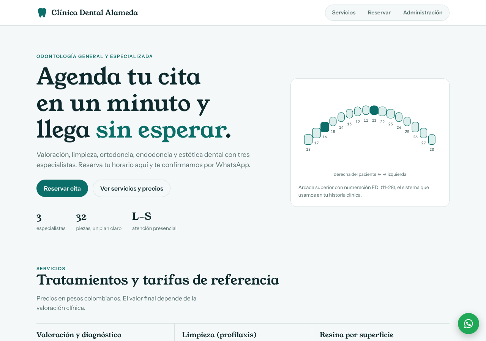
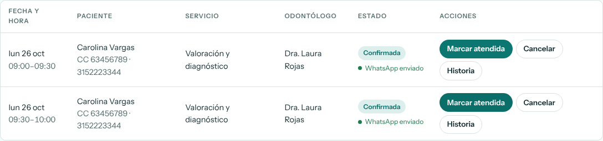

# Clínica Dental Alameda

Sistema web para una clínica odontológica: sitio público con reserva de citas en línea y panel de administración con gestión de citas, pacientes e historia clínica con odontograma FDI.





**Video demo (54 s):** [docs/video/clinica_dental_demo.mp4](docs/video/clinica_dental_demo.mp4) · reserva → confirmación con WhatsApp → historia clínica.

## Stack

| Capa | Tecnología |
|---|---|
| Backend | ASP.NET Core 8 Web API, Clean Architecture (Domain / Application / Infrastructure / Api) |
| Persistencia | PostgreSQL 16 + Entity Framework Core 8 (Npgsql), migraciones |
| Seguridad | JWT Bearer, contraseñas con BCrypt, rate limiting en reservas y login |
| Frontend | Angular 19 (standalone components, signals, lazy loading, interceptor y guard funcionales) |
| Notificaciones | WhatsApp vía Twilio con cola outbox, worker en segundo plano y reintentos |
| Seguridad | Roles (Admin, Recepción, Odontólogo), contraseñas temporales con cambio obligatorio, auditoría de la historia clínica |
| Pruebas | xUnit (dominio, agenda, WhatsApp, roles, auditoría y consentimiento) — 45 pruebas |
| Despliegue | Docker Compose; en producción con Caddy (HTTPS automático) y respaldos diarios verificados |

## Funcionalidades

**Sitio público**
- Servicios con duración y precio de referencia (COP), equipo y horario.
- Reserva en 5 pasos: servicio → odontólogo → fecha → hora → datos. Los horarios ocupados aparecen tachados.
- Consulta de citas propias con cédula + celular.
- Autorización obligatoria de tratamiento de datos (Ley 1581) con página de política en `/privacidad`, y autorización aparte para avisos por WhatsApp.
- Botón flotante de WhatsApp.

**Panel de administración** (`/admin`, requiere login)
- **Roles:** Recepción (agenda), Odontólogo (agenda e historia clínica) y Administrador (todo, más usuarios y auditoría). Cada usuario recibe una contraseña temporal y debe cambiarla al primer ingreso.
- Indicadores: citas de hoy, por confirmar, confirmadas y total de pacientes.
- Citas con filtros por estado, odontólogo, fecha y búsqueda por nombre o cédula.
- Flujo de estados: `Pendiente → Confirmada → Atendida`, y cancelación desde Pendiente o Confirmada.
- **WhatsApp automático** al confirmar o cancelar: la tabla muestra si el aviso está en cola, enviado o falló (con el motivo y botón para reenviar). Ver [docs/WHATSAPP.md](docs/WHATSAPP.md).
- **Historia clínica inmutable:** cada registro guarda su autor; los errores se anulan con motivo, nunca se editan ni se borran.
- **Auditoría** (Resolución 1995 de 1999): quién consultó o modificó cada historia, cuándo y desde qué IP.
- Historia clínica: antecedentes y alergias, procedimientos por pieza dental en notación FDI (11–48), odontograma que resalta las piezas tratadas.

## Reglas de negocio importantes

- **Horario:** L–V 8:00–12:00 y 14:00–18:00; sábado 8:00–12:00; domingo cerrado. Inicios cada 30 min.
- **Duración real:** una endodoncia (90 min) bloquea todos los horarios que se cruzan y no puede pasar del bloque (no cruza el almuerzo).
- **Sin reservas dobles:** chequeo de cruce dentro de una transacción `SERIALIZABLE` + índice único parcial en PostgreSQL (`OdontologoId, Fecha, HoraInicio` para citas activas). Probado con 8 reservas simultáneas al mismo horario: 1 éxito, 7 rechazadas con 409.
- Reservas hasta 60 días adelante; no se aceptan horarios pasados (zona horaria `America/Bogota`).
- El paciente se identifica por cédula: si ya existe se actualizan sus datos de contacto.

Ver la decisión de arquitectura en [docs/ADR-001-arquitectura.md](docs/ADR-001-arquitectura.md).

## Cómo ejecutarlo

### Opción 1: Docker (todo junto)

```bash
cp .env.example .env        # cambia las claves
docker compose up --build
```

- Sitio: http://localhost:8080
- Panel: http://localhost:8080/admin — usuario `admin@dentalalameda.co`, contraseña `Admin123*` (o los de tu `.env`)
- Swagger: http://localhost:5080/swagger

### Opción 2: desarrollo local

Requisitos: .NET 8 SDK, Node 20+, PostgreSQL 16.

```bash
# 1. Base de datos
createuser -P dental            # contraseña: dental
createdb -O dental dental_alameda

# 2. API (aplica migraciones y datos iniciales al arrancar)
cd backend
dotnet test
dotnet run --project src/DentalAlameda.Api --urls http://localhost:5080

# 3. Frontend (proxy de /api hacia :5080)
cd ../frontend
npm install
npx ng serve                    # http://localhost:4200
```

## API

| Método | Ruta | Acceso |
|---|---|---|
| GET | `/api/servicios` · `/api/odontologos` | Público |
| GET | `/api/disponibilidad?odontologoId&servicioId&fecha` | Público |
| POST | `/api/citas` | Público (10/min por IP) |
| GET | `/api/citas/consulta?cedula&celular` | Público |
| POST | `/api/auth/login` | Público (5/min por IP) |
| GET | `/api/admin/citas?estado&odontologoId&desde&hasta&q` · `/api/admin/citas/resumen` | JWT |
| PATCH | `/api/admin/citas/{id}/estado` | JWT |
| GET | `/api/admin/pacientes?q` · `/api/admin/pacientes/{id}` (queda auditado) | JWT Admin/Odontólogo |
| PUT | `/api/admin/pacientes/{id}/antecedentes` | JWT |
| POST | `/api/admin/citas/{id}/whatsapp` (reenviar aviso) | JWT |
| POST | `/api/auth/cambiar-password` | JWT |
| POST | `/api/admin/pacientes/{id}/historia/{registroId}/anular` | JWT Admin/Odontólogo |
| GET · POST · PATCH | `/api/admin/usuarios` · `/{id}/restablecer-password` · `/{id}/activo` | JWT Admin |
| GET | `/api/admin/auditoria?pacienteId&desde&hasta&accion` | JWT Admin |
| POST | `/api/admin/pacientes/{id}/historia` | JWT |

Los errores se devuelven como `ProblemDetails` con mensajes en español (404 no existe, 409 regla de negocio, 400 validación).

## Estructura

```
backend/
  src/DentalAlameda.Domain          Entidades, reglas (estados de cita, FDI, horario)
  src/DentalAlameda.Application     DTOs y casos de uso (agenda, citas, pacientes, auth)
  src/DentalAlameda.Infrastructure  EF Core + PostgreSQL, migraciones, JWT, BCrypt, seed
  src/DentalAlameda.Api             Controladores, middleware de errores, rate limiting, Swagger
  tests/DentalAlameda.Tests         Pruebas xUnit
frontend/src/app/
  core/     API, auth (servicio, interceptor, guard), modelos, formato
  sitio/    Portada y flujo de reserva
  admin/    Login, panel, citas, pacientes
  shared/   Odontograma FDI
```

## Producción

Guía paso a paso en [docs/DEPLOY.md](docs/DEPLOY.md): servidor, dominio, HTTPS automático, secretos, primer ingreso, respaldos y restauración, y lista de verificación antes de abrir al público.

```bash
cp .env.production.example .env   # completar secretos y dominio
docker compose -f docker-compose.prod.yml up -d --build
```

Pendiente del lado de la clínica: NIT y correo de datos en la política (revisada por un abogado) y plantillas de WhatsApp aprobadas por Meta ([docs/WHATSAPP.md](docs/WHATSAPP.md)).

Mejoras sugeridas: recordatorio 24 h antes de la cita, festivos colombianos y bloqueos de agenda por odontólogo.
